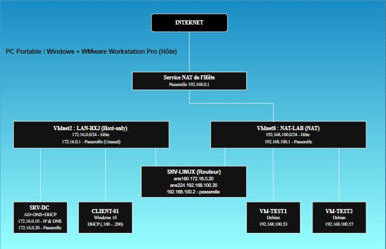
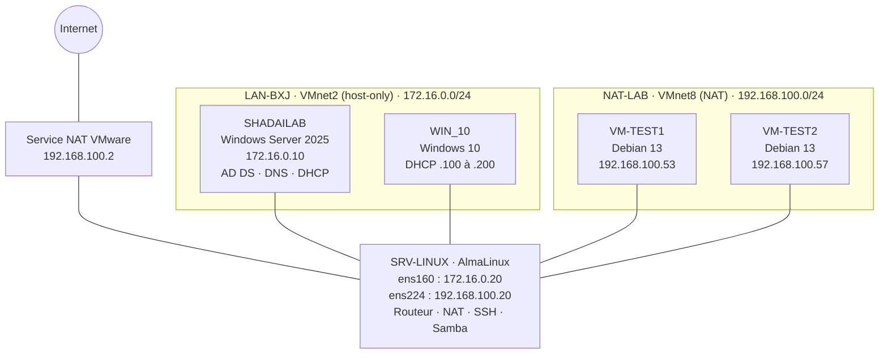
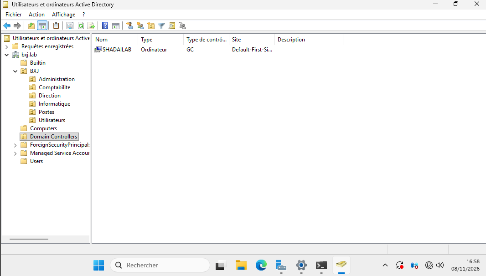
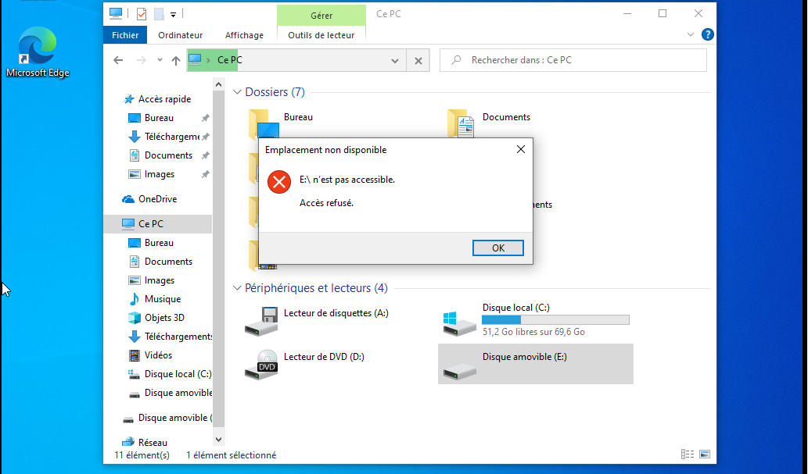
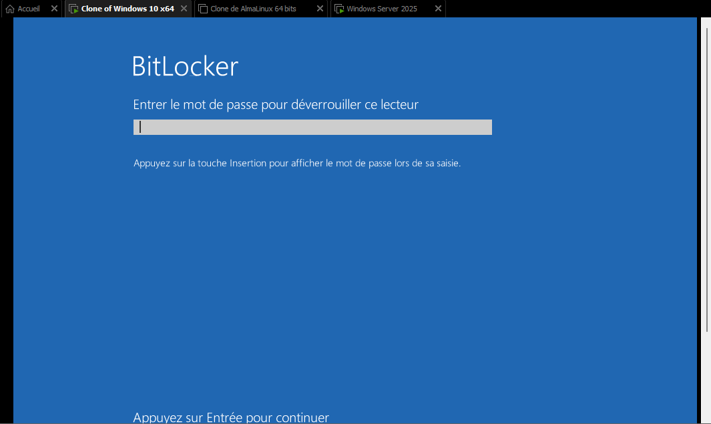
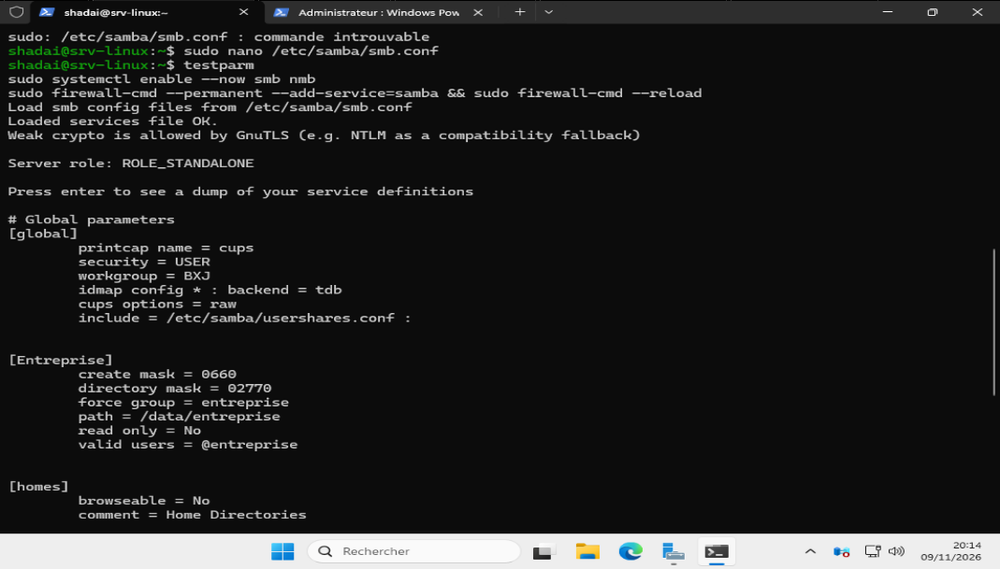

# BXJ Lab Infrastructure

> Maquette complète d'infrastructure d'entreprise pour **BXJ Technologies** : Active Directory, DHCP/DNS, GPO, BitLocker, routage et pare-feu Linux, SSH, Samba et sauvegarde — le tout virtualisé sous VMware Workstation Pro.

🇫🇷 Français · [🇬🇧 English](README_EN.md)



## Présentation

Projet pratique de fin de **Module 5** (formation Réseaux & Cybersécurité, Kadea Academy). BXJ Technologies souhaite centraliser l'authentification et l'administration d'un parc d'environ cinquante postes. La maquette reconstruit cette infrastructure de zéro dans un nouveau domaine Active Directory, **`bxj.lab`**, porté par le contrôleur de domaine **SHADAILAB** (Windows Server 2025, `172.16.0.10`).

Tout est automatisé par des scripts **PowerShell** (côté Windows) et **Bash** (côté Linux). Les scripts Active Directory sont **idempotents** : on peut les relancer sans risque, un objet déjà présent est vérifié et corrigé au lieu d'être recréé.
**Vidéo de démonstration :** [Voir la vidéo sur LinkedIn](https://lnkd.in/p/dQe4YeGf)
## Architecture



**SRV-LINUX** est la passerelle par défaut de toutes les machines : `172.16.0.20` pour le LAN-BXJ, `192.168.100.20` pour les VM de test. Sa propre route par défaut pointe vers le service NAT de VMware. Ce point de passage unique concentre le routage et le filtrage (`firewalld`).

### Machines virtuelles

| Machine | Système | Rôle |
|---|---|---|
| SHADAILAB (SRV-DC) | Windows Server 2025 | Contrôleur de domaine `bxj.lab` : AD DS, DNS, DHCP, GPO, référence de temps |
| WIN_10 (CLIENT-01) | Windows 10 | Poste membre du domaine : DHCP, GPO, BitLocker, cible RDP |
| SRV-LINUX | AlmaLinux | Routeur entre les deux réseaux, NAT, SSH, partage Samba, sauvegarde |
| VM-TEST1 / VM-TEST2 | Debian 13 | Machines du réseau NAT-LAB : preuves de NAT, d'Internet et de routage |

### Plan d'adressage

| Équipement | Interface | IP | Passerelle | DNS | Mode |
|---|---|---|---|---|---|
| SHADAILAB | Ethernet0 | 172.16.0.10/24 | 172.16.0.20 | 172.16.0.10 | Statique |
| SRV-LINUX | ens160 | 172.16.0.20/24 | 192.168.100.2 | 8.8.8.8 | Statique |
| SRV-LINUX | ens224 | 192.168.100.20/24 | 192.168.100.2 | 192.168.100.2, 8.8.8.8 | Statique |
| WIN_10 | Ethernet0 | 172.16.0.100 à .200 | 172.16.0.20 | 172.16.0.10 | DHCP |
| VM-TEST1 | ens33 | 192.168.100.53/24 | 192.168.100.20 | 8.8.8.8 | Statique |
| VM-TEST2 | ens33 | 192.168.100.57/24 | 192.168.100.20 | 8.8.8.8 | Statique |

## Structure du dépôt

```
.
├── README.md / README_EN.md
├── LICENSE
├── docs/
│   └── rapport-technique.pdf        # Rapport complet (51 pages, 42 figures)
├── scripts/
│   ├── powershell/                  # À exécuter sur SHADAILAB
│   │   ├── 01-ou-groupes-comptes.ps1
│   │   ├── 02-gpo.ps1
│   │   ├── 03-dhcp.ps1
│   │   └── 04-w32tm.ps1
│   └── linux/                       # À exécuter sur SRV-LINUX
│       ├── 05-routage.sh
│       ├── 06-firewalld.sh
│       └── 07-backup-restore.sh
└── evidence/
    ├── architecture.png
    └── captures/                    # fig01 à fig42, numérotées comme dans le rapport
```

## Scripts

| Script | Machine | Rôle |
|---|---|---|
| `01-ou-groupes-comptes.ps1` | SHADAILAB | Crée l'OU `BXJ`, ses 6 sous-OU, 5 groupes `GRP-<service>` et 10 comptes. Le domaine est détecté avec `Get-ADDomain` : aucun nom écrit en dur. Le mot de passe temporaire est saisi à l'exécution, jamais stocké. |
| `02-gpo.ps1` | SHADAILAB | Crée `GPO-Blocage-USB` et `GPO-Verrouillage-Session`, liées à `OU=Postes,OU=BXJ`. |
| `03-dhcp.ps1` | SHADAILAB | Étendue `LAN_BXJ`, exclusions, options routeur / DNS / suffixe `bxj.lab`. |
| `04-w32tm.ps1` | SHADAILAB | Source de temps fiable (Kerberos tolère 5 minutes d'écart au maximum). |
| `05-routage.sh` | SRV-LINUX | Adresses statiques, `ip_forward` permanent, masquerade. |
| `06-firewalld.sh` | SRV-LINUX | Zones `internal` / `external` et politiques `int_to_ext` / `ext_to_int`. |
| `07-backup-restore.sh` | SRV-LINUX | Sauvegarde datée et vérifiée, rétention 7 jours, restauration ciblée, journal. |

**Ordre conseillé :** `05` → `06` (réseau), puis `01` → `02` → `03` → `04` (domaine), et `07` pour la sauvegarde.

**Prérequis :** rôles AD DS, DNS et DHCP installés sur SHADAILAB, serveur DHCP autorisé dans Active Directory, objet ordinateur de WIN_10 dans l'OU `Postes`.

```powershell
# Sur SHADAILAB (PowerShell administrateur)
.\scripts\powershell\01-ou-groupes-comptes.ps1
```

```bash
# Sur SRV-LINUX
chmod +x scripts/linux/*.sh
sudo ./scripts/linux/05-routage.sh
sudo ./scripts/linux/07-backup-restore.sh backup
```

## Fonctionnalités démontrées

| Domaine | Résultat | Preuve |
|---|---|---|
| Réseaux virtuels VMware | VMnet2 host-only, VMnet8 NAT | `fig05` |
| Routage LAN ↔ NAT-LAB ↔ Internet | Pings croisés réussis (TTL 127 et 63) | `fig09` à `fig12` |
| Active Directory | Domaine `bxj.lab`, OU, 10 comptes, 5 groupes | `fig14`, `fig15` |
| Mots de passe | 12 caractères, historique 5, verrouillage 3 échecs / 10 min | `fig17` |
| DHCP | Étendue `LAN_BXJ`, serveur autorisé | `fig21` à `fig23` |
| GPO | Blocage USB (accès refusé), verrouillage de session à 3 min | `fig26`, `fig27` |
| BitLocker | VM chiffrée, déverrouillage au démarrage | `fig28` à `fig31` |
| Bureau à distance | Session RDP SHADAILAB → WIN_10 | `fig32` à `fig34` |
| SSH | Connexion avec compte nominatif, compte inconnu refusé | `fig35`, `fig36` |
| Samba | Partage `Entreprise` validé par `testparm`, services activés | `fig37`, `fig38` |

Le rapport signale aussi ce qui n'est **pas** illustré par une capture : exécution du script de sauvegarde, verrouillage de session après 3 minutes, résultat de `w32tm /query /status`.

### Captures clés

| Structure Active Directory | GPO : clé USB refusée |
|---|---|
|  |  |

| BitLocker au démarrage | SSH et Samba |
|---|---|
|  |  |

## Audit de sécurité et limites

Le rapport identifie les risques de cette maquette et leurs corrections. Principaux points :

- **Élevé** : SRV-LINUX est le point de passage unique ; `ext_to_int` accepte tout le trafic NAT-LAB → LAN → à restreindre aux flux nécessaires et journaliser les refus.
- **Élevé** : mot de passe initial identique pour les dix comptes → mots de passe uniques et MFA en production (changement obligatoire à la première connexion déjà en place).
- **Moyen** : RDP et SSH par mot de passe, certificat RDP auto-signé → NLA, clés SSH, fail2ban, VPN.
- **Moyen** : sauvegardes sur le serveur protégé, contrôleur de domaine unique → copie externe (règle 3-2-1), second contrôleur.

L'analyse complète est dans [`docs/rapport-technique.pdf`](docs/rapport-technique.pdf).

## Environnement

VMware Workstation Pro · Windows Server 2025 · Windows 10 · AlmaLinux · Debian 13 · PowerShell · Bash · firewalld · Samba · OpenSSH

## Auteur

**LESENGE NGANI Shadai** — Réseaux & Cybersécurité

## Licence

Distribué sous licence [MIT](LICENSE). Projet réalisé en laboratoire à des fins pédagogiques.
