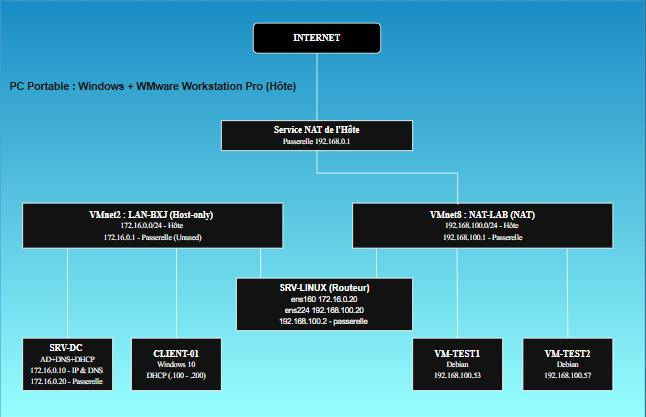
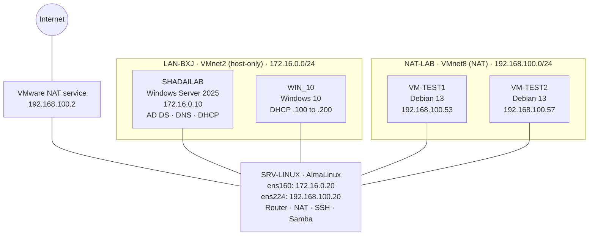
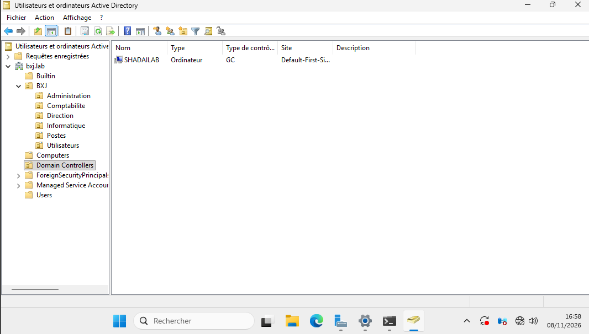
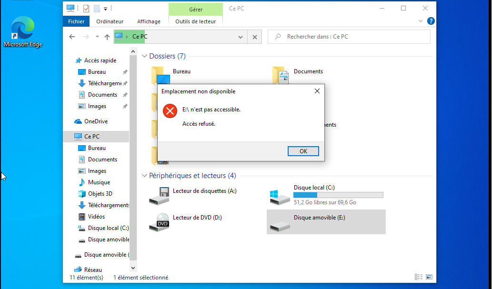
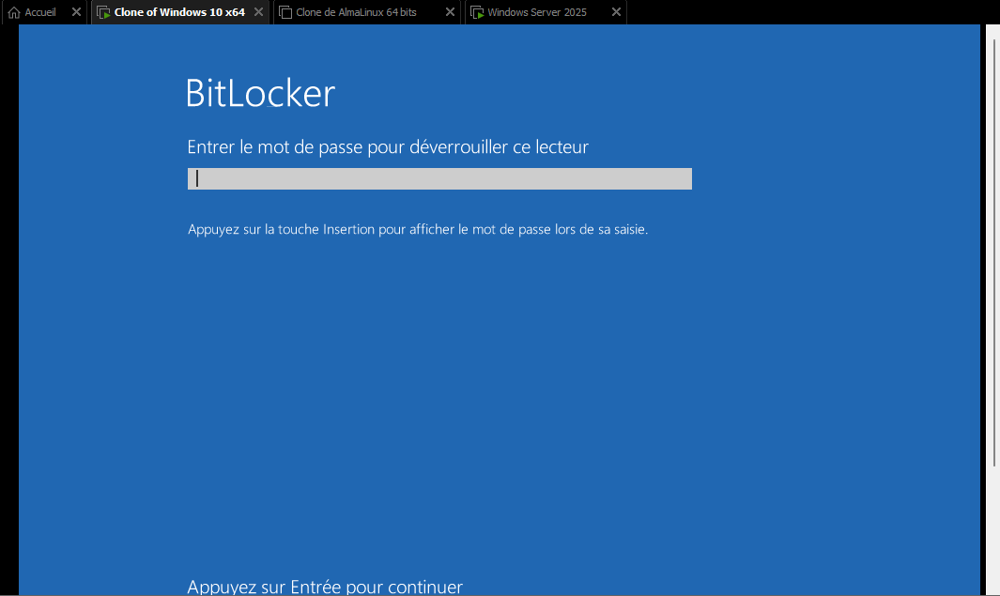
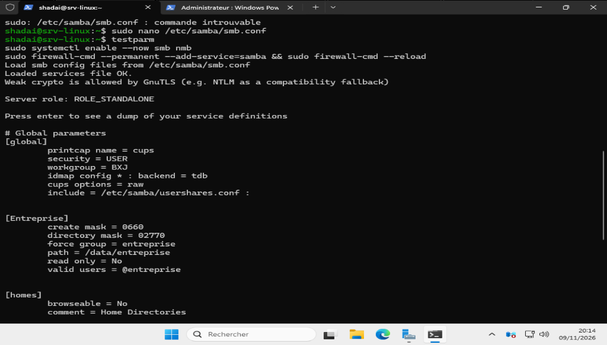

# BXJ Lab Infrastructure

> A complete enterprise infrastructure lab for **BXJ Technologies**: Active Directory, DHCP/DNS, Group Policy, BitLocker, Linux routing and firewall, SSH, Samba and backup — all virtualized on VMware Workstation Pro.

[🇫🇷 Français](README.md) · 🇬🇧 English



## Overview

End-of-**Module 5** hands-on project (Networks & Cybersecurity training, Kadea Academy). BXJ Technologies wants to centralize authentication and administration for about fifty workstations. The lab rebuilds the whole infrastructure from scratch in a new Active Directory domain, **`bxj.lab`**, hosted by the domain controller **SHADAILAB** (Windows Server 2025, `172.16.0.10`).

Everything is automated with **PowerShell** (Windows) and **Bash** (Linux). The Active Directory scripts are **idempotent**: they can be re-run safely, an existing object is checked and fixed instead of being recreated.

## Architecture



**SRV-LINUX** is the default gateway of every machine: `172.16.0.20` for LAN-BXJ, `192.168.100.20` for the test VMs. Its own default route points to the VMware NAT service. This single crossing point concentrates routing and filtering (`firewalld`).

### Virtual machines

| Machine | OS | Role |
|---|---|---|
| SHADAILAB (SRV-DC) | Windows Server 2025 | `bxj.lab` domain controller: AD DS, DNS, DHCP, GPO, time reference |
| WIN_10 (CLIENT-01) | Windows 10 | Domain member: DHCP, GPO, BitLocker, RDP target |
| SRV-LINUX | AlmaLinux | Router between both networks, NAT, SSH, Samba share, backup |
| VM-TEST1 / VM-TEST2 | Debian 13 | NAT-LAB machines: proof of NAT, Internet access and routing |

### IPv4 addressing plan

| Device | Interface | IP | Gateway | DNS | Mode |
|---|---|---|---|---|---|
| SHADAILAB | Ethernet0 | 172.16.0.10/24 | 172.16.0.20 | 172.16.0.10 | Static |
| SRV-LINUX | ens160 | 172.16.0.20/24 | — | — | Static |
| SRV-LINUX | ens224 | 192.168.100.20/24 | 192.168.100.2 | 192.168.100.2, 8.8.8.8 | Static |
| WIN_10 | Ethernet0 | 172.16.0.100 to .200 | 172.16.0.20 | 172.16.0.10 | DHCP |
| VM-TEST1 | ens33 | 192.168.100.53/24 | 192.168.100.20 | 8.8.8.8 | Static |
| VM-TEST2 | ens33 | 192.168.100.57/24 | 192.168.100.20 | 8.8.8.8 | Static |

## Repository layout

```
.
├── README.md / README_EN.md
├── LICENSE
├── docs/
│   └── rapport-technique.pdf        # Full report (French, 51 pages, 42 figures)
├── scripts/
│   ├── powershell/                  # Run on SHADAILAB
│   │   ├── 01-ou-groupes-comptes.ps1
│   │   ├── 02-gpo.ps1
│   │   ├── 03-dhcp.ps1
│   │   └── 04-w32tm.ps1
│   └── linux/                       # Run on SRV-LINUX
│       ├── 05-routage.sh
│       ├── 06-firewalld.sh
│       └── 07-backup-restore.sh
└── evidence/
    ├── architecture.png
    └── captures/                    # fig01 to fig42, numbered as in the report
```

## Scripts

| Script | Machine | Purpose |
|---|---|---|
| `01-ou-groupes-comptes.ps1` | SHADAILAB | Creates the `BXJ` OU, 6 sub-OUs, 5 `GRP-<service>` groups and 10 accounts. The domain is detected with `Get-ADDomain`: nothing is hard-coded. The temporary password is typed at run time, never stored. |
| `02-gpo.ps1` | SHADAILAB | Creates `GPO-Blocage-USB` and `GPO-Verrouillage-Session`, linked to `OU=Postes,OU=BXJ`. |
| `03-dhcp.ps1` | SHADAILAB | `LAN_BXJ` scope, exclusions, router / DNS / `bxj.lab` suffix options. |
| `04-w32tm.ps1` | SHADAILAB | Reliable time source (Kerberos tolerates at most 5 minutes of clock skew). |
| `05-routage.sh` | SRV-LINUX | Static addresses, permanent `ip_forward`, masquerade. |
| `06-firewalld.sh` | SRV-LINUX | `internal` / `external` zones and `int_to_ext` / `ext_to_int` policies. |
| `07-backup-restore.sh` | SRV-LINUX | Dated and verified backup, 7-day retention, targeted restore, log file. |

**Suggested order:** `05` → `06` (network), then `01` → `02` → `03` → `04` (domain), and `07` for backups.

**Prerequisites:** AD DS, DNS and DHCP roles installed on SHADAILAB, DHCP server authorized in Active Directory, WIN_10 computer object placed in the `Postes` OU.

```powershell
# On SHADAILAB (elevated PowerShell)
.\scripts\powershell\01-ou-groupes-comptes.ps1
```

```bash
# On SRV-LINUX
chmod +x scripts/linux/*.sh
sudo ./scripts/linux/05-routage.sh
sudo ./scripts/linux/07-backup-restore.sh backup
```

## Demonstrated features

| Area | Result | Evidence |
|---|---|---|
| VMware virtual networks | VMnet2 host-only, VMnet8 NAT | `fig05` |
| LAN ↔ NAT-LAB ↔ Internet routing | Cross pings succeed (TTL 127 and 63) | `fig09` to `fig12` |
| Active Directory | `bxj.lab` domain, OUs, 10 accounts, 5 groups | `fig14`, `fig15` |
| Passwords | 12 characters, history of 5, lockout after 3 failures / 10 min | `fig17` |
| DHCP | `LAN_BXJ` scope, authorized server | `fig21` to `fig23` |
| Group Policy | USB blocked (access denied), session lock after 3 min | `fig26`, `fig27` |
| BitLocker | Encrypted VM, unlock prompt at boot | `fig28` to `fig31` |
| Remote Desktop | RDP session SHADAILAB → WIN_10 | `fig32` to `fig34` |
| SSH | Named account works, unknown account refused | `fig35`, `fig36` |
| Samba | `Entreprise` share validated with `testparm`, services enabled | `fig37`, `fig38` |

The report also states what is **not** backed by a screenshot: backup script execution, session lock after 3 minutes, and the output of `w32tm /query /status`.

### Key screenshots

| Active Directory structure | GPO: USB drive denied |
|---|---|
|  |  |

| BitLocker at boot | SSH and Samba |
|---|---|
|  |  |

## Security audit and limits

The report lists the risks of this lab and their fixes. Main points:

- **High**: SRV-LINUX is the single crossing point; `ext_to_int` accepts all NAT-LAB → LAN traffic → restrict to required flows and log denials.
- **High**: same initial password for the ten accounts → unique passwords and MFA in production (forced change at first logon is already in place).
- **Medium**: RDP and SSH by password, self-signed RDP certificate → NLA, SSH keys, fail2ban, VPN.
- **Medium**: backups stored on the server they protect, single domain controller → off-site copy (3-2-1 rule), second domain controller.

The full analysis is in [`docs/rapport-technique.pdf`](docs/rapport-technique.pdf) (written in French).

## Environment

VMware Workstation Pro · Windows Server 2025 · Windows 10 · AlmaLinux · Debian 13 · PowerShell · Bash · firewalld · Samba · OpenSSH

## Author

**LESENGE NGANI Shadai** — Networks & Cybersecurity

## License

Released under the [MIT](LICENSE) license. Lab project built for educational purposes.
